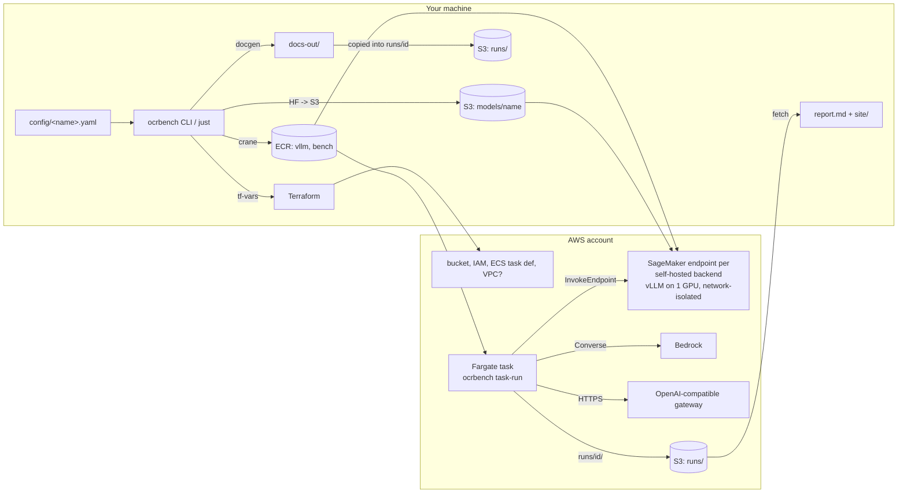

# Architecture

## Components

| Component | Role | Notes |
|---|---|---|
| `docgen` | HTML → PDF (headless Chrome) → PNG (pdfium), plus a degraded "photo" variant | Ground truth comes from the same calls that write the HTML, so the two can't drift |
| SageMaker endpoints | One per self-hosted backend (`kind: selfhosted`); each serves its model with vLLM's OpenAI server (`/ping` and `/invocations` on :8080) | Container runs network-isolated; SageMaker mounts weights from S3 at `/opt/ml/model` |
| Fargate runner | Runs the requested stages (`transcribe`, `extract`, `score`, `summarize`) inside the VPC and syncs `runs/<id>/` to S3 after each | Needed when backends are only reachable privately; otherwise use `runner.mode: local` |
| Backends | One interface: `complete(Request) -> Response` | Runners don't know which provider they're talking to |
| Scorer | Page metrics, field accuracy, latency and cost aggregates | Pure function of the files in `runs/<id>/` |
| Recommender | Stage 4 (`summarize`): an LLM (`bench.summary.agent`) interprets the computed key facts and writes the recommendation (`summary.md`, `summary.json`) | Labelled LLM-written; every number it writes is checked against the key facts |
| Site | Experiments index → run page → document page; static HTML, no external resources | Open via `file://` or zip a run's folder |

## Reading and extraction

Stage 1 (`transcribe`) shows how well each backend **reads**. Stage 2 (`extract`) is closer to
how a document pipeline would use OCR: an extractor (by default the agent,
`bench.extraction.agent`) extracts per-type fields such as totals, dates, account numbers and
checked boxes, and the result is scored field by field. Pipelines are `<source>-><extractor>`:

- `<self-hosted>->agent`, e.g. `unlimited-ocr->agent`: the self-hosted model reads, then the LLM extracts from the text (cheap input, two hops).
- `<llm>->agent`: the same, with an LLM transcript.
- `image->agent`: the LLM extracts straight from the images (one hop, image-token cost).
- `<input>-><backend>`: any of the above with a named extractor instead of the default agent.

End-to-end latency and cost of `X->agent` add X's per-page figures to the extraction call;
the exact rules (which run is scored, how a GPU's per-page cost is derived) are in
[AGENTS.md: How results are scored](../AGENTS.md#how-results-are-scored-dont-change-silently).

## One description of a run

`run.json` is the only input to scoring and reporting. `view.py` turns it into the names,
roles, prices and pipeline descriptions that report.md, the site and the recommendation prompt
all use; `metrics.py` defines every metric column (label, format, better direction, glossary)
once; `prompts.py` holds the prompt defaults that a run records.

## Why these choices

- **SageMaker instead of an EC2 GPU box.** Managed hosts, scale to zero by deleting the
  endpoint, and they work in accounts that restrict EC2 AMIs. Instance pools cope with
  scarce GPU capacity.
- **crane instead of docker.** Works on machines without a Docker daemon and with corporate
  proxies. A layer append is seconds, and the 9 GB base image is copied registry-to-registry
  once.
- **Weights in S3, pinned revision and SHA-256.** The endpoint needs no internet access, and
  the exact model bytes are auditable through `models/<name>.manifest.json`.
- **Network.** `network.mode: existing` reuses your VPC and private subnets. `create` builds a
  small VPC (`infra/terraform/network/`): 2 private subnets for the runner, 1 public subnet with
  a NAT gateway for egress to Bedrock, Hugging Face and gateways, and an S3 gateway endpoint.
  The NAT gateway bills per hour while the stack exists (~$32/month idle, plus data processing);
  `just endpoint-down` doesn't remove it, `just destroy` does.
- **One config feeding Terraform.** Redeploying to another account means writing another
  YAML file; no code or `.tf` edits.
